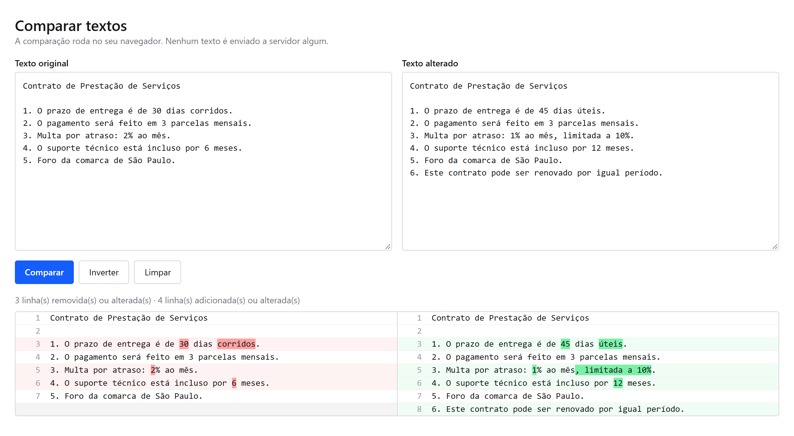
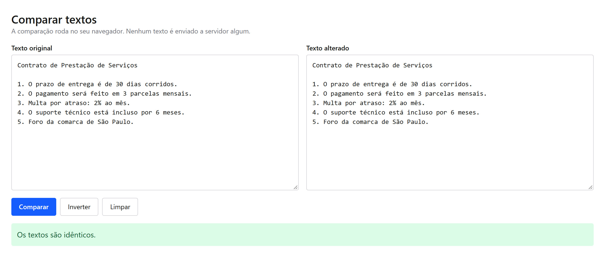

<div align="center">

# 🔍 Comparar Textos

### Veja em segundos o que mudou entre duas versões de um texto, sem enviar nada para a internet.

Diff (comparação) lado a lado, com destaque **palavra por palavra**, que roda **no navegador** ou como **app desktop portátil**.

[](https://nextjs.org)
[](https://react.dev)
[](https://www.electronjs.org)
[](https://www.typescriptlang.org)
[](LICENSE)

[**⬇️ Baixar para Windows**](https://github.com/renatopardini/text-compare/releases/latest) · [Rodar na web](#-versão-web) · [Como funciona](#-como-funciona)

<br>



</div>

---

## ✨ Por que usar

Contratos, documentos, configurações, respostas de API, trechos de código: os sites de comparação pedem que você **cole seus textos no servidor de outra pessoa**. Este app não faz isso.

- 🔒 **100% privado:** a comparação roda no seu computador. Não há backend, banco de dados, rastreamento ou chamada de rede. Funciona até sem internet.
- 🎯 **Destaque palavra por palavra:** além da linha alterada, você vê exatamente **qual palavra** mudou, em vermelho (removido) e verde (adicionado).
- ↔️ **Lado a lado e numerado:** original à esquerda, nova versão à direita, com linhas alinhadas e numeradas.
- 📊 **Resumo instantâneo:** quantas linhas foram removidas, alteradas ou adicionadas.
- 🔁 **Inverter e limpar com um clique:** troque os lados para ver a mudança no sentido oposto.
- 🌗 **Tema claro e escuro automáticos:** segue a preferência do seu sistema.
- 🪟 **Quebras de linha do Windows, Linux e macOS:** textos com `CRLF` e `LF` são comparados sem falsas diferenças.
- ⚡ **Leve e instantâneo:** sem login, sem anúncios, sem espera.

## 🖥️ Duas formas de usar, o mesmo app

| | 🌐 **Web** | 💼 **Desktop (Windows)** |
|---|---|---|
| **Como abre** | No navegador, local ou hospedado | Clique duplo no `.exe` |
| **Instalação** | Nenhuma | **Nenhuma**: é um executável portátil |
| **Precisa de admin?** | Não | Não |
| **Funciona offline?** | Sim, depois de carregado | Sim, sempre |
| **Ideal para** | Usar em qualquer sistema ou compartilhar com a equipe | PCs corporativos onde não é possível instalar programas |

> 💡 **Pensado para o PC da empresa:** o executável portátil roda direto de uma pasta, do pendrive ou da área de trabalho, sem instalador e sem permissão de administrador.

## 📸 Telas

<table>
  <tr>
    <td width="50%"></td>
    <td width="50%"></td>
  </tr>
  <tr>
    <td align="center"><b>Tema escuro</b>, automático pelo sistema</td>
    <td align="center"><b>Textos idênticos?</b> O app avisa na hora</td>
  </tr>
</table>

## 🚀 Começando

### 💼 App desktop (Windows)

1. Acesse a página de [**Releases**](https://github.com/renatopardini/text-compare/releases/latest).
2. Baixe o arquivo `CompararTextos-<versão>-portable.exe`.
3. Dê um clique duplo. Pronto.

> ⚠️ Como o executável ainda não tem assinatura digital, o Windows pode mostrar o aviso **"O Windows protegeu o computador"**. Clique em **Mais informações → Executar assim mesmo**.

### 🌐 Versão web

Requisito: [Node.js](https://nodejs.org) 20.9 ou superior.

```bash
git clone https://github.com/renatopardini/text-compare.git
cd text-compare
npm install
npm run dev
```

Abra **http://127.0.0.1:3000** no navegador.

#### Hospedar para a sua equipe

O app não depende de servidor, então pode ser publicado como site estático em qualquer hospedagem (Vercel, Netlify, Nginx, IIS etc.):

```bash
npm run build:static   # gera HTML, CSS e JS puros na pasta out/
```

Basta publicar o conteúdo de `out/`.

## 🛠️ Para desenvolvedores

### Scripts

| Comando | O que faz |
|---|---|
| `npm run dev` | Servidor de desenvolvimento em http://127.0.0.1:3000 |
| `npm run build` e `npm start` | Versão web otimizada com servidor Next.js |
| `npm run build:static` | Export estático em `out/` (sem servidor) |
| `npm run desktop` | Abre o app desktop (Electron) a partir de `out/` |
| `npm run dist` | Gera o `.exe` portátil em `dist/` |
| `npm test` | Testes da lógica de comparação |
| `npm run lint` | Verificação de código (ESLint) |

### 🧠 Como funciona

```
 Texto original ─┐
                 ├─► diffLines ──► linhas iguais / removidas / adicionadas
 Texto alterado ─┘                        │
                                          ▼
                     pares removida+adicionada ──► diffWordsWithSpace
                                          │         (destaque por palavra)
                                          ▼
                              tabela lado a lado e numerada
```

- **[`src/lib/diffRows.ts`](src/lib/diffRows.ts)**: o núcleo. Normaliza as quebras de linha, compara linha a linha com a biblioteca [`diff`](https://github.com/kpdecker/jsdiff) e, quando uma linha foi substituída, compara de novo **palavra por palavra** para marcar só o trecho que mudou.
- **[`src/app/page.tsx`](src/app/page.tsx)**: a interface (React com Tailwind CSS). É um Client Component, então tudo roda no navegador.
- **[`electron/main.mjs`](electron/main.mjs)**: o app desktop. Abre uma janela que serve o export estático por um protocolo interno (`app://`), com isolamento de contexto e *sandbox* ativados. Links externos abrem no seu navegador, nunca dentro do app.

### Estrutura

```
text-compare/
├── src/
│   ├── app/            # interface (Next.js App Router)
│   └── lib/            # lógica de comparação e testes
├── electron/           # processo principal do app desktop
├── docs/screenshots/   # imagens deste README
└── next.config.ts      # export estático ativado por "build:static"
```

### Gerando uma nova versão desktop

1. Atualize `version` no `package.json`.
2. Rode `npm run dist`.
3. Publique `dist/CompararTextos-<versão>-portable.exe` em uma nova [Release](https://github.com/renatopardini/text-compare/releases/new).

> 💡 **Rodando pelo terminal do VS Code?** Se o Electron falhar com `does not provide an export named 'BrowserWindow'`, a variável `ELECTRON_RUN_AS_NODE` está definida no seu terminal. Remova-a (`Remove-Item Env:ELECTRON_RUN_AS_NODE` no PowerShell) e rode de novo.

## 🤝 Contribuindo

Contribuições são bem-vindas!

1. Faça um *fork* do projeto.
2. Crie uma branch: `git checkout -b minha-melhoria`.
3. Confirme que os testes passam: `npm test` e `npm run lint`.
4. Abra um *Pull Request* explicando o que mudou e por quê.

Encontrou um bug ou tem uma ideia? [Abra uma issue](https://github.com/renatopardini/text-compare/issues).

## 📄 Licença

Distribuído sob a licença MIT. Veja [`LICENSE`](LICENSE).

<div align="center">
<br>

Feito com ☕ por **Renato Pardini**. Se este projeto te ajudou, deixe uma ⭐!

</div>
