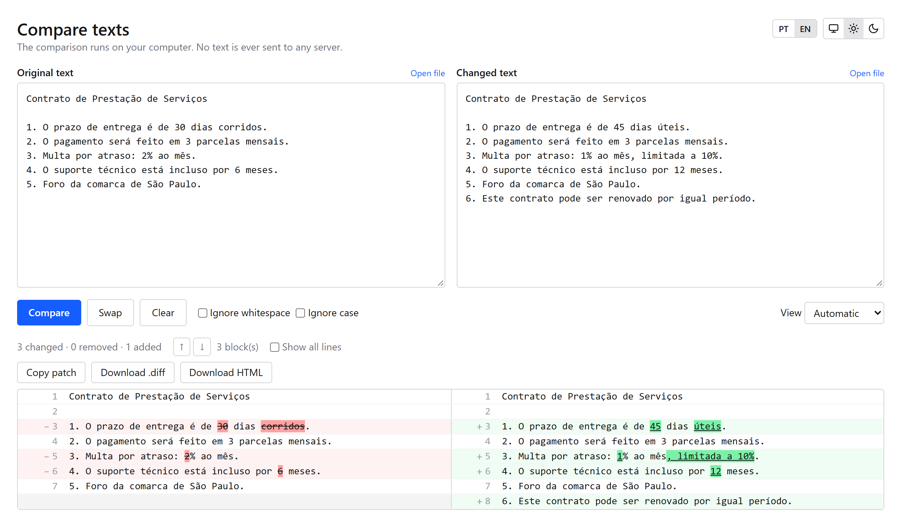
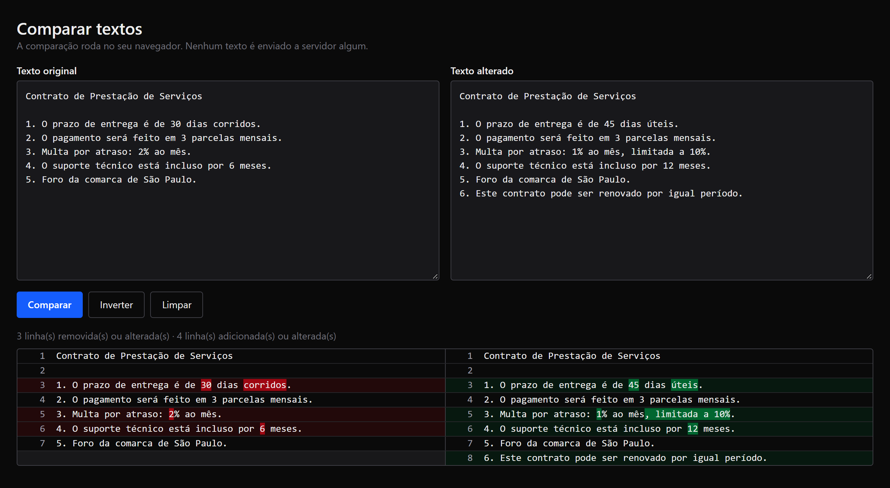

<div align="center">

🇺🇸 English | [🇧🇷 Português](README.pt-BR.md)


# Compare Texts

### See in seconds what changed between two versions of a text, without sending anything to the internet.

Side-by-side diff (comparison) with **word-by-word** highlighting that runs **in the browser** or as a **portable desktop app**.

[](https://nextjs.org)
[](https://react.dev)
[](https://www.electronjs.org)
[](https://www.typescriptlang.org)
[](LICENSE)

[**⬇️ Download for Windows or Linux**](https://github.com/renatopardini/text-compare/releases/latest) · [Run on the web](#-web-version) · [How it works](#-how-it-works)

<br>



</div>

---

## ✨ Why use it

Contracts, documents, configuration files, API responses, code snippets: comparison websites ask you to **paste your texts into someone else's server**. This app doesn't.

- 🔒 **100% private:** the comparison runs on your computer. There is no backend, database, tracking or network call. It even works offline. Only your preferences (theme, language, options) are saved; your texts, never.
- 🎯 **Word-by-word highlighting:** besides the changed line, you see exactly **which word** changed, in red and struck through (removed) and in green and underlined (added). The `−`/`+` signs keep everything readable even if you can't tell the colors apart.
- ⚡ **Compares as you type:** no need to click. `Ctrl+Enter` compares right away.
- 🐘 **Huge texts without freezing:** 100,000 lines show up in under 1 second, with smooth scrolling. The work runs in the background.
- 📂 **Open or drop files:** one on each side, or both at once. Correct accents in UTF-8, UTF-16 and old Notepad files (ANSI/Windows-1252).
- 🧭 **Jump between differences:** ↑/↓ buttons or `F7`/`Shift+F7`. Long unchanged stretches are collapsed and open with one click.
- ↔️ **Side by side or unified:** the automatic mode switches to unified on narrow screens.
- 🙈 **Ignore whitespace and case:** to see only what matters.
- 📤 **Export the result:** copy the patch (`git diff` format), download the `.diff` or an HTML file to send to someone.
- 🌗 **Light, dark or system theme** and **Portuguese or English interface.**
- 🪟 **Windows, Linux and macOS line endings:** texts with `CRLF` and `LF` are compared without false differences.

## 🖥️ Two ways to use it, the same app

| | 🌐 **Web** | 💼 **Desktop (Windows and Linux)** |
|---|---|---|
| **How it opens** | In the browser, local or hosted | Double-click the `.exe` or the `.AppImage` |
| **Installation** | None | **None**: it's a portable executable |
| **Needs admin?** | No | No |
| **Works offline?** | Yes, once loaded | Yes, always |
| **Best for** | Any operating system, or sharing with your team | Corporate PCs where you can't install software |

> 💡 **Made for the office PC:** the portable executable runs straight from a folder, a USB stick or the desktop, with no installer and no administrator permission.

## 📸 Screenshots

<table>
  <tr>
    <td width="40%"></td>
    <td width="40%"></td>
    <td width="20%"></td>
  </tr>
  <tr>
    <td align="center"><b>Dark theme</b>, from the system or chosen</td>
    <td align="center"><b>Identical texts?</b> The app tells you right away</td>
    <td align="center"><b>Unified mode</b> on narrow screens</td>
  </tr>
</table>

## ⌨️ Shortcuts

| Key | What it does |
|---|---|
| `Ctrl+Enter` | Compares right away, without waiting for a pause in typing |
| `F7` | Goes to the next difference |
| `Shift+F7` | Goes back to the previous difference |

> `F7` and `Shift+F7` do nothing while the cursor is inside a text field, so they don't get in the way of typing.

## 🚀 Getting started

### 💼 Desktop app (Windows)

1. Go to the [**Releases**](https://github.com/renatopardini/text-compare/releases/latest) page.
2. Download `CompararTextos-<version>-portable.exe`.
3. Double-click it. Done.

> ⚠️ Since the executable isn't digitally signed yet, Windows may show **"Windows protected your PC"**. Click **More info → Run anyway**.

### 🐧 Desktop app (Linux)

1. Download `CompararTextos-<version>-x86_64.AppImage` from the [**Releases**](https://github.com/renatopardini/text-compare/releases/latest) page.
2. Make it executable: `chmod +x CompararTextos-*.AppImage`.
3. Open it with a double-click or from the terminal: `./CompararTextos-*.AppImage`.

> 💡 On Ubuntu 22.04 or newer, the AppImage needs the `libfuse2` package: `sudo apt install libfuse2` (on 24.04 the package is called `libfuse2t64`).

### 🌐 Web version

Requirement: [Node.js](https://nodejs.org) 20.9 or newer.

```bash
git clone https://github.com/renatopardini/text-compare.git
cd text-compare
npm install
npm run dev
```

Open **http://127.0.0.1:3000** in your browser.

#### Hosting it for your team

The app doesn't need a server, so it can be published as a static site on any host (Vercel, Netlify, Nginx, IIS, etc.):

```bash
npm run build:static   # generates plain HTML, CSS and JS in out/
```

Just publish the contents of `out/`.

## 🛠️ For developers

### Scripts

| Command | What it does |
|---|---|
| `npm run dev` | Development server at http://127.0.0.1:3000 |
| `npm run build` and `npm start` | Optimized web version with the Next.js server |
| `npm run build:static` | Static export in `out/` (no server) |
| `npm run desktop` | Opens the desktop app (Electron) from `out/` |
| `npm run dist` | Builds the portable `.exe` in `dist/` |
| `npm run dist:linux` | Builds the `.AppImage` in `dist/` (run it on Linux) |
| `npm test` | Logic tests (comparison, view, files, preferences, export). Requires Node.js 22.18+ |
| `npm run lint` | Code checks (ESLint) |
| `npm run smoke` | Smoke test in the real desktop app (requires `build:static`) |
| `npm run screenshots` | Regenerates the screenshots in this README (requires `build:static`) |

### 🧠 How it works

```
                         Web Worker (off the UI thread)
 Original text ──┐   ┌──────────────────────────────────────────────────┐
                 ├─► │ anchors ──► gaps between anchors ──► diffArrays  │
 Changed text ───┘   │ (lines unique          │             (Myers)     │
                     │  on both sides)        ▼                         │
                     │      removed+added pairs ──► diffWords           │
                     │                        │     (word highlighting) │
                     └────────────────────────┼─────────────────────────┘
                                              ▼
                        virtualized list: side by side or unified
```

- **[`src/lib/diffRows.ts`](src/lib/diffRows.ts)**: the core. It first finds the **anchors**: lines that appear exactly once in each text, in the same order (the idea behind Git's *patience diff*). They split the problem into small pieces, and only those pieces go through the Myers algorithm from the [`diff`](https://github.com/kpdecker/jsdiff) library. When a line was replaced, it compares again **word by word**. There is a 2 s limit: if it's exceeded, the rest is compared in a simplified way, with a warning.
- **[`src/lib/diff.worker.ts`](src/lib/diff.worker.ts)** and **[`src/hooks/useDiff.ts`](src/hooks/useDiff.ts)**: the work runs in a Web Worker, so the screen never freezes. The latest request always wins: an old result never replaces a newer one.
- **[`src/lib/view.ts`](src/lib/view.ts)**: collapses long unchanged stretches and builds the unified mode.
- **[`src/components/`](src/components/)**: the interface (React with Tailwind CSS). Above 2,000 lines, only the visible ones are drawn ([`@tanstack/react-virtual`](https://tanstack.com/virtual)).
- **[`electron/main.mjs`](electron/main.mjs)**: the desktop app. It opens a window that serves the static export through an internal protocol (`app://`), with context isolation and *sandbox* enabled. External links open in your browser, never inside the app.

### Structure

```
text-compare/
├── src/
│   ├── app/            # page and layout (Next.js App Router)
│   ├── components/     # interface components
│   ├── hooks/          # background comparison and preferences
│   └── lib/            # pure logic (comparison, files, languages, export) and tests
├── scripts/            # smoke test and screenshots, via Electron + DevTools
├── .github/workflows/  # CI and Release publishing
├── electron/           # desktop app main process
├── docs/screenshots/   # images for this README
└── next.config.ts      # static export enabled by "build:static"
```

### Publishing a new version

1. Update `version` in `package.json` and commit to `main`.
2. Create and push the tag: `git tag v<version>` and then `git push origin v<version>`.
3. GitHub Actions runs the tests, builds the `.exe` (Windows) and the `.AppImage` (Linux) and publishes the [Release](https://github.com/renatopardini/text-compare/releases) with both files.

### ⚠️ Limitations

- **`Ctrl+F` on large results:** above 2,000 lines, only the visible lines exist on the page, so the browser search can't find the rest. Use the ↑/↓ navigation or scroll to the spot.
- **Texts with no lines in common:** when almost no line repeats between the two sides, the work may hit the 2 s limit. In that case that stretch is compared in a simplified way (line by line, in order) and the app warns you.
- **Exported patch:** always assumes the file ends with a line break.

> 💡 **Running from the VS Code terminal?** If Electron fails with `does not provide an export named 'BrowserWindow'`, the `ELECTRON_RUN_AS_NODE` variable is set in your terminal. Remove it (`Remove-Item Env:ELECTRON_RUN_AS_NODE` in PowerShell) and run again.

## 🤝 Contributing

Contributions are welcome!

1. Fork the project.
2. Create a branch: `git checkout -b my-improvement`.
3. Make sure the tests pass: `npm test` and `npm run lint`.
4. Open a *Pull Request* explaining what changed and why.

Found a bug or have an idea? [Open an issue](https://github.com/renatopardini/text-compare/issues).

## 📄 License

Distributed under the MIT license. See [`LICENSE`](LICENSE).

<div align="center">
<br>

Made with ☕ by **Renato Pardini**. If this project helped you, leave a ⭐!

</div>
