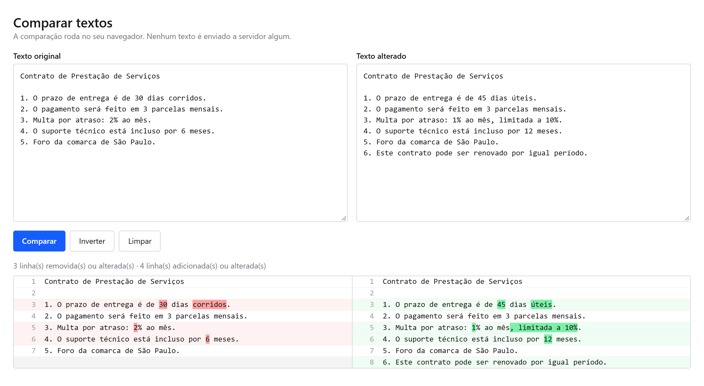
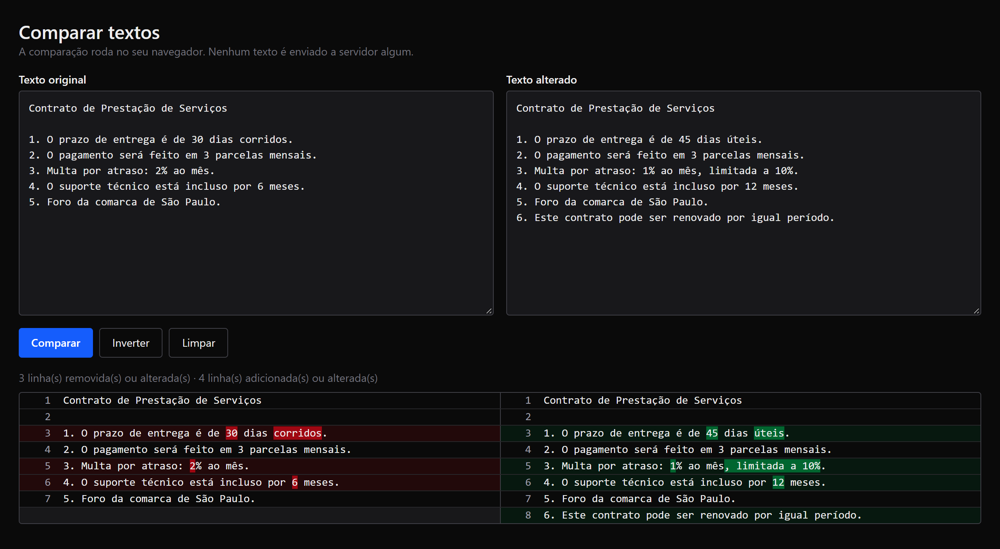
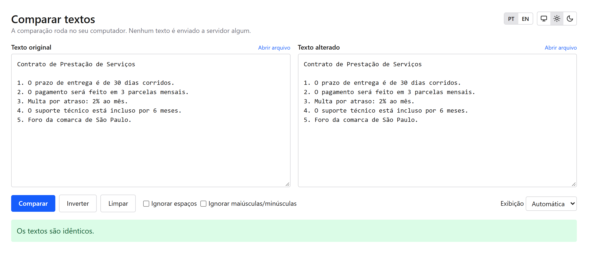
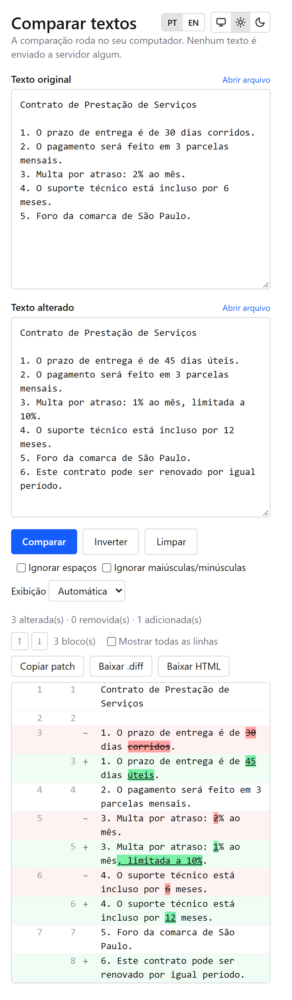

<div align="center">

[🇺🇸 English](README.md) | 🇧🇷 Português


# Comparar Textos

### Veja em segundos o que mudou entre duas versões de um texto, sem enviar nada para a internet.

Diff (comparação) lado a lado, com destaque **palavra por palavra**, que roda **no navegador** ou como **app desktop portátil**.

[](https://nextjs.org)
[](https://react.dev)
[](https://www.electronjs.org)
[](https://www.typescriptlang.org)
[](LICENSE)

[**⬇️ Baixar para Windows ou Linux**](https://github.com/renatopardini/text-compare/releases/latest) · [Rodar na web](#-versão-web) · [Como funciona](#-como-funciona)

<br>



</div>

---

## ✨ Por que usar

Contratos, documentos, configurações, respostas de API, trechos de código: os sites de comparação pedem que você **cole seus textos no servidor de outra pessoa**. Este app não faz isso.

- 🔒 **100% privado:** a comparação roda no seu computador. Não há backend, banco de dados, rastreamento ou chamada de rede. Funciona até sem internet. Só as suas preferências (tema, idioma, opções) ficam salvas; os textos, nunca.
- 🎯 **Destaque palavra por palavra:** além da linha alterada, você vê exatamente **qual palavra** mudou, em vermelho e tachado (removido) e em verde e sublinhado (adicionado). Os sinais `−`/`+` deixam tudo legível mesmo sem distinguir cores.
- ⚡ **Compara sozinho enquanto você digita:** sem precisar clicar. `Ctrl+Enter` compara na hora.
- 🐘 **Textos enormes sem travar:** 100 mil linhas aparecem em menos de 1 segundo, com rolagem fluida. O cálculo roda em segundo plano.
- 📂 **Abra ou arraste arquivos:** um em cada lado, ou os dois de uma vez. Acentos certos em arquivos UTF-8, UTF-16 e nos antigos do Bloco de Notas (ANSI/Windows-1252).
- 🧭 **Navegue entre as diferenças:** botões ↑/↓ ou `F7`/`Shift+F7`. Trechos longos sem mudança ficam recolhidos e abrem com um clique.
- ↔️ **Lado a lado ou unificado:** o modo automático usa o unificado em telas estreitas.
- 🙈 **Ignorar espaços e maiúsculas/minúsculas:** para ver só o que importa.
- 📤 **Exporte o resultado:** copie o patch (formato do `git diff`), baixe o `.diff` ou um HTML para enviar a alguém.
- 🌗 **Tema claro, escuro ou do sistema** e **interface em português ou inglês.**
- 🪟 **Quebras de linha do Windows, Linux e macOS:** textos com `CRLF` e `LF` são comparados sem falsas diferenças.

## 🖥️ Duas formas de usar, o mesmo app

| | 🌐 **Web** | 💼 **Desktop (Windows e Linux)** |
|---|---|---|
| **Como abre** | No navegador, local ou hospedado | Clique duplo no `.exe` ou no `.AppImage` |
| **Instalação** | Nenhuma | **Nenhuma**: é um executável portátil |
| **Precisa de admin?** | Não | Não |
| **Funciona offline?** | Sim, depois de carregado | Sim, sempre |
| **Ideal para** | Usar em qualquer sistema ou compartilhar com a equipe | PCs corporativos onde não é possível instalar programas |

> 💡 **Pensado para o PC da empresa:** o executável portátil roda direto de uma pasta, do pendrive ou da área de trabalho, sem instalador e sem permissão de administrador.

## 📸 Telas

<table>
  <tr>
    <td width="40%"></td>
    <td width="40%"></td>
    <td width="20%"></td>
  </tr>
  <tr>
    <td align="center"><b>Tema escuro</b>, pelo sistema ou escolhido</td>
    <td align="center"><b>Textos idênticos?</b> O app avisa na hora</td>
    <td align="center"><b>Modo unificado</b> em telas estreitas</td>
  </tr>
</table>

## ⌨️ Atalhos

| Tecla | O que faz |
|---|---|
| `Ctrl+Enter` | Compara na hora, sem esperar a pausa na digitação |
| `F7` | Vai para a próxima diferença |
| `Shift+F7` | Volta para a diferença anterior |

> `F7` e `Shift+F7` não agem com o cursor dentro de um campo de texto, para não atrapalhar a digitação.

## 🚀 Começando

### 💼 App desktop (Windows)

1. Acesse a página de [**Releases**](https://github.com/renatopardini/text-compare/releases/latest).
2. Baixe o arquivo `CompararTextos-<versão>-portable.exe`.
3. Dê um clique duplo. Pronto.

> ⚠️ Como o executável ainda não tem assinatura digital, o Windows pode mostrar o aviso **"O Windows protegeu o computador"**. Clique em **Mais informações → Executar assim mesmo**.

### 🐧 App desktop (Linux)

1. Baixe `CompararTextos-<versão>-x86_64.AppImage` na página de [**Releases**](https://github.com/renatopardini/text-compare/releases/latest).
2. Dê permissão de execução: `chmod +x CompararTextos-*.AppImage`.
3. Abra com clique duplo ou pelo terminal: `./CompararTextos-*.AppImage`.

> 💡 No Ubuntu 22.04 ou mais novo, o AppImage precisa do pacote `libfuse2`: `sudo apt install libfuse2` (no 24.04, o pacote se chama `libfuse2t64`).

### 🌐 Versão web

Requisito: [Node.js](https://nodejs.org) 20.9 ou superior.

```bash
git clone https://github.com/renatopardini/text-compare.git
cd text-compare
npm install
npm run dev
```

Abra **http://127.0.0.1:3000** no navegador.

#### Hospedar para a sua equipe

O app não depende de servidor, então pode ser publicado como site estático em qualquer hospedagem (Vercel, Netlify, Nginx, IIS etc.):

```bash
npm run build:static   # gera HTML, CSS e JS puros na pasta out/
```

Basta publicar o conteúdo de `out/`.

## 🛠️ Para desenvolvedores

### Scripts

| Comando | O que faz |
|---|---|
| `npm run dev` | Servidor de desenvolvimento em http://127.0.0.1:3000 |
| `npm run build` e `npm start` | Versão web otimizada com servidor Next.js |
| `npm run build:static` | Export estático em `out/` (sem servidor) |
| `npm run desktop` | Abre o app desktop (Electron) a partir de `out/` |
| `npm run dist` | Gera o `.exe` portátil em `dist/` |
| `npm run dist:linux` | Gera o `.AppImage` em `dist/` (rode no Linux) |
| `npm test` | Testes da lógica (comparação, visualização, arquivos, preferências, exportação). Requer Node.js 22.18+ |
| `npm run lint` | Verificação de código (ESLint) |
| `npm run smoke` | Teste de fumaça no app desktop real (requer `build:static`) |
| `npm run screenshots` | Regera os prints deste README (requer `build:static`) |

### 🧠 Como funciona

```
                         Web Worker (fora da thread da tela)
 Texto original ─┐   ┌──────────────────────────────────────────────────┐
                 ├─► │ âncoras ──► vãos entre âncoras ──► diffArrays    │
 Texto alterado ─┘   │ (linhas únicas         │           (Myers)       │
                     │  nos dois lados)       ▼                         │
                     │      pares removida+adicionada ──► diffWords     │
                     │                        │     (destaque por palavra)
                     └────────────────────────┼─────────────────────────┘
                                              ▼
                        lista virtualizada: lado a lado ou unificada
```

- **[`src/lib/diffRows.ts`](src/lib/diffRows.ts)**: o núcleo. Primeiro acha as **âncoras**: linhas que aparecem exatamente uma vez em cada texto, na mesma ordem (a ideia do *patience diff* do Git). Elas dividem o problema em pedaços pequenos, e só esses pedaços passam pelo algoritmo de Myers da biblioteca [`diff`](https://github.com/kpdecker/jsdiff). Quando uma linha foi substituída, compara de novo **palavra por palavra**. Há um limite de 2 s: se estourar, o trecho restante é comparado de forma simplificada, com aviso.
- **[`src/lib/diff.worker.ts`](src/lib/diff.worker.ts)** e **[`src/hooks/useDiff.ts`](src/hooks/useDiff.ts)**: o cálculo roda num Web Worker, então a tela nunca trava. O último pedido sempre vence: um resultado antigo nunca aparece no lugar de um mais novo.
- **[`src/lib/view.ts`](src/lib/view.ts)**: recolhe trechos longos sem mudança e monta o modo unificado.
- **[`src/components/`](src/components/)**: a interface (React com Tailwind CSS). Acima de 2.000 linhas, só as visíveis são desenhadas ([`@tanstack/react-virtual`](https://tanstack.com/virtual)).
- **[`electron/main.mjs`](electron/main.mjs)**: o app desktop. Abre uma janela que serve o export estático por um protocolo interno (`app://`), com isolamento de contexto e *sandbox* ativados. Links externos abrem no seu navegador, nunca dentro do app.

### Estrutura

```
text-compare/
├── src/
│   ├── app/            # página e layout (Next.js App Router)
│   ├── components/     # componentes da interface
│   ├── hooks/          # comparação em segundo plano e preferências
│   └── lib/            # lógica pura (comparação, arquivos, idiomas, exportação) e testes
├── scripts/            # teste de fumaça e prints, via Electron + DevTools
├── .github/workflows/  # CI e publicação de Releases
├── electron/           # processo principal do app desktop
├── docs/screenshots/   # imagens deste README
└── next.config.ts      # export estático ativado por "build:static"
```

### Publicando uma nova versão

1. Atualize `version` no `package.json` e faça o commit na `main`.
2. Crie e envie a tag: `git tag v<versão>` e depois `git push origin v<versão>`.
3. O GitHub Actions roda os testes, gera o `.exe` (Windows) e o `.AppImage` (Linux) e publica a [Release](https://github.com/renatopardini/text-compare/releases) com os dois arquivos.

### ⚠️ Limitações

- **`Ctrl+F` em resultados grandes:** acima de 2.000 linhas, só as linhas visíveis existem na página, então a busca do navegador não encontra o resto. Use a navegação ↑/↓ ou role até o trecho.
- **Textos sem nenhuma linha em comum:** quando quase nenhuma linha se repete entre os dois lados, o cálculo pode estourar o limite de 2 s. Nesse caso o trecho é comparado de forma simplificada (linha a linha, na ordem) e o app avisa.
- **Patch exportado:** sempre considera que o arquivo termina com quebra de linha.

> 💡 **Rodando pelo terminal do VS Code?** Se o Electron falhar com `does not provide an export named 'BrowserWindow'`, a variável `ELECTRON_RUN_AS_NODE` está definida no seu terminal. Remova-a (`Remove-Item Env:ELECTRON_RUN_AS_NODE` no PowerShell) e rode de novo.

## 🤝 Contribuindo

Contribuições são bem-vindas!

1. Faça um *fork* do projeto.
2. Crie uma branch: `git checkout -b minha-melhoria`.
3. Confirme que os testes passam: `npm test` e `npm run lint`.
4. Abra um *Pull Request* explicando o que mudou e por quê.

Encontrou um bug ou tem uma ideia? [Abra uma issue](https://github.com/renatopardini/text-compare/issues).

## 📄 Licença

Distribuído sob a licença MIT. Veja [`LICENSE`](LICENSE).

<div align="center">
<br>

Feito com ☕ por **Renato Pardini**. Se este projeto te ajudou, deixe uma ⭐!

</div>
